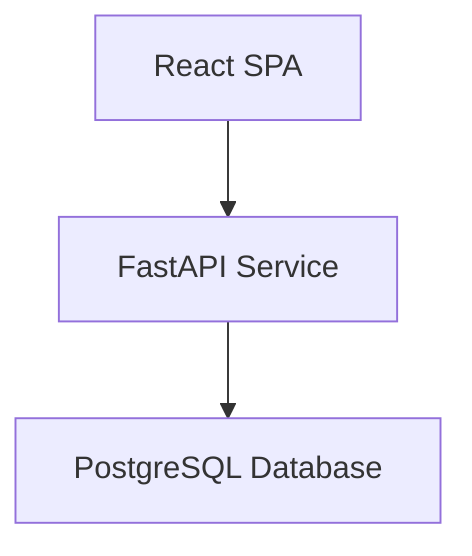
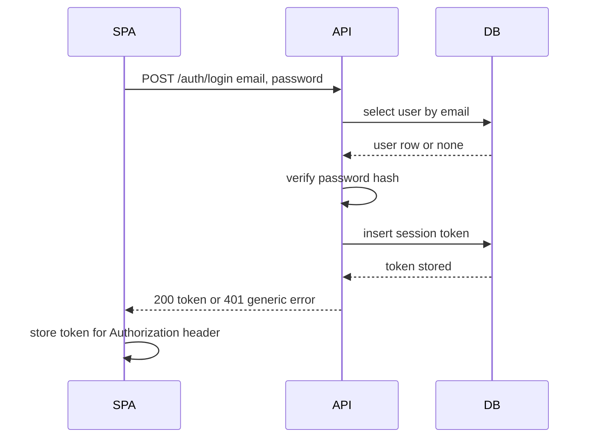
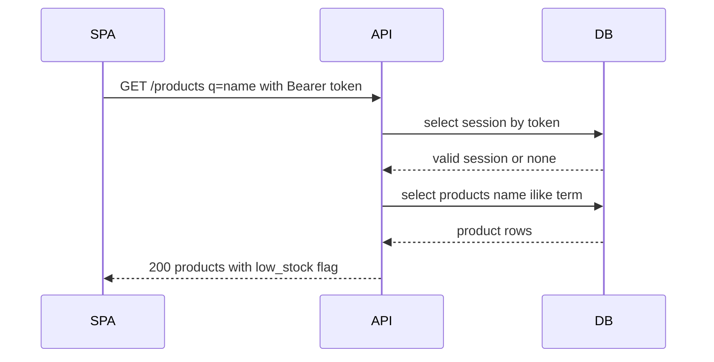
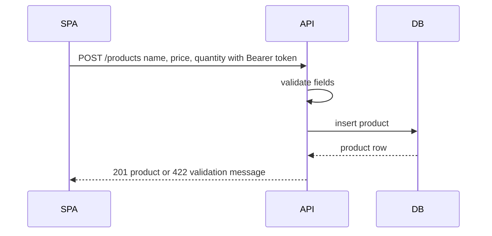
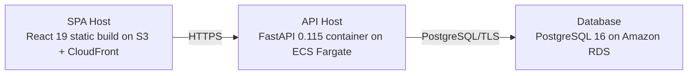

# Architecture

> Maintained by QuorQ AI SDLC. Text between `sdlc:auto` markers is regenerated; anything outside them is yours and is kept.

<!-- sdlc:auto:start narrative -->
## Overview

### ARCH-SUMMARY · approved · source: architecture

Overall architecture is approved (version 1): a single-location inventory app with a React SPA, FastAPI API, and PostgreSQL database on AWS.

Lightweight single-location inventory web app. A React 19 SPA (served from one origin) talks to a FastAPI 0.115 JSON API (separate origin), backed by PostgreSQL 16 on AWS. Staff register and sign in with email and password; sessions are server-side opaque bearer tokens stored in Postgres, revoked on sign-out or expiry. Signed-in staff share one product list they can view, search by name, add to, edit, delete, and adjust stock on, with an in-app low-stock flag when quantity falls below 5. Price is a USD informational field only. No external services beyond the approved stack are required.

**Related:** US-001, US-002, US-003, US-004, US-005, US-006, US-007, US-008, US-009, US-010, US-011, US-012

### ARCH-COMPONENT-SPA · approved · source: architecture:spa

The React 19 SPA is the sole client, rendering the product table/forms and auth screens, and carrying the bearer token on every API call.

Component: spa - React SPA (React 19). Responsibilities: responsive product table and forms covering login/register, list/search, add/edit/delete products, update stock, and show the low-stock flag. Stores the bearer token client-side and sends it on every API call.

**Related:** US-001, US-002, US-003, US-004, US-005, US-006, US-007, US-008, US-009, US-010

### ARCH-COMPONENT-API · approved · source: architecture:api

The FastAPI service is the single JSON API for authentication and product management, enforcing validation and session checks.

Component: api - FastAPI Service (FastAPI 0.115). Responsibilities: JSON API for auth (register, login, logout), session validation, product CRUD, stock update, and name search. Validates input and enforces that only signed-in staff reach product endpoints.

**Related:** US-001, US-002, US-003, US-004, US-005, US-006, US-007, US-008, US-009, US-010, US-011, US-012

### ARCH-COMPONENT-DB · approved · source: architecture:db

PostgreSQL 16 stores user accounts, session tokens, and the shared product list, and serves name searches.

Component: db - PostgreSQL Database (PostgreSQL 16). Stores user accounts (hashed passwords), opaque session tokens, and the shared product list. Serves name searches via case-insensitive LIKE.

**Related:** US-006, US-008, US-009, US-010, US-011

### ARCH-PATH-LOGIN · approved · source: architecture:critical-path

Sign-in flow establishes an opaque, server-side session token on successful credential verification.

Staff submit email and password. The API verifies the password hash, creates an opaque session token row in Postgres, and returns the token in the response body. A non-revealing error is returned on any credential mismatch (does not disclose whether email or password was wrong).

**Related:** US-009

### ARCH-PATH-SEARCH · approved · source: architecture:critical-path

Authenticated product listing/search returns matching products with a derived low-stock flag.

The SPA requests the product list with an optional name query, sending the bearer token. The API validates the session and returns matching products, each flagged low-stock when quantity is below 5.

**Related:** US-002, US-006, US-007

### ARCH-PATH-VALIDATION · approved · source: architecture:critical-path

Adding or updating a product enforces name, price, and quantity validation before persisting.

Staff submit product fields. The API validates: name non-blank, price non-negative, quantity a whole number of zero or more. Valid submissions are persisted and the resulting product returned. Invalid input yields a 422 response explaining what to fix.

**Related:** US-001, US-003, US-005, US-012

### ARCH-DATA-MODEL · approved · source: architecture:entities

Three entities back the system: users, sessions, and products.

users: id, email, password_hash, created_at. sessions: token, user_id, created_at, expires_at. products: id, name, price_usd, quantity, created_at, updated_at.

**Related:** US-001, US-002, US-005, US-008, US-009, US-010, US-011

### ARCH-ENDPOINTS · approved · source: architecture:endpoints

Nine REST endpoints cover auth and product management.

POST /auth/register - create account with email/password, rejects already-used email. POST /auth/login - sign in, returns opaque bearer token in body. POST /auth/logout - revoke current session token. GET /auth/me - return signed-in user, used by SPA to confirm active session. GET /products - list products, optional case-insensitive name search via q, each item carries derived low_stock flag. POST /products - add a product, validates name, non-negative price, whole non-negative quantity. PUT /products/{id} - edit name/price/quantity with same validation. PATCH /products/{id}/quantity - update only stock quantity to a whole number >= 0. DELETE /products/{id} - delete a product (confirmation handled in the SPA).

**Related:** US-001, US-002, US-003, US-004, US-005, US-006, US-007, US-008, US-009, US-010, US-011, US-012

### ARCH-DEPLOYMENT · approved · source: architecture:deployment-nodes

Three deployment nodes on AWS: static SPA host, containerized API host, and managed database.

SPA Host: React 19 static build (Vite build) on S3 + CloudFront. API Host: FastAPI 0.115 container on ECS Fargate, running Python 3.12 / Uvicorn. Database: PostgreSQL 16 on Amazon RDS (managed PostgreSQL 16).

### ARCH-TECH-FRONTEND · approved · source: architecture:technology-decisions

React 19 selected for the frontend over Vue and Svelte.

Decision: React 19 (alternatives considered: Vue, Svelte). Rationale: drives the single searchable product table with add/edit/delete/stock-update forms and instant client-side filtering; built as a Vite SPA served from its own origin and reading VITE_API_BASE_URL.

**Related:** US-001, US-002, US-003, US-004, US-005, US-006, US-007

### ARCH-TECH-BACKEND · approved · source: architecture:technology-decisions

FastAPI 0.115 selected for the backend over Django REST Framework and Flask.

Decision: FastAPI 0.115 (alternatives considered: Django REST Framework, Flask). Rationale: serves the small fixed JSON API (auth plus product CRUD and stock update) with Pydantic validation covering the name/price/quantity rules.

**Related:** US-001, US-002, US-003, US-004, US-005, US-006, US-012

### ARCH-TECH-DB · approved · source: architecture:technology-decisions

PostgreSQL 16 selected for the database over MySQL and SQLite.

Decision: PostgreSQL 16 (alternatives considered: MySQL, SQLite). Rationale: holds users, sessions and the shared product list; case-insensitive LIKE on an indexed name column handles search well into low thousands of rows.

**Related:** US-006, US-008, US-009

### ARCH-TECH-CLOUD · approved · source: architecture:technology-decisions

AWS selected as the cloud provider over GCP and Azure.

Decision: AWS (alternatives considered: GCP, Azure). Rationale: S3/CloudFront for the SPA, ECS Fargate for the API, and RDS for PostgreSQL, with managed backups and encryption, all suited to light usage.
<!-- sdlc:auto:end narrative -->

<!-- sdlc:auto:start building-blocks -->
## Building Block View

| ID | Name | Technology | Responsibility | Depends on |
|---|---|---|---|---|
| spa | React SPA | React 19 | Responsive product table and forms: login/register, list/search, add/edit/delete products, update stock, show low-stock flag. Stores the bearer token and sends it on every API call. | api |
| api | FastAPI Service | FastAPI 0.115 | JSON API for auth (register, login, logout), session validation, product CRUD, stock update, and name search. Validates input and enforces that only signed-in staff reach product endpoints. | db |
| db | PostgreSQL Database | PostgreSQL 16 | Stores user accounts (hashed passwords), opaque session tokens, and the shared product list. Serves name searches via case-insensitive LIKE. | — |

<!-- sdlc:auto:end building-blocks -->

<!-- sdlc:auto:start runtime -->
## Runtime View

### Sign in and establish session

Staff submit email and password. The API verifies the hash, creates an opaque session token row, and returns the token in the response body. A non-revealing error is returned on any mismatch.

- **Components:** spa, api, db
- **Modules:** auth_router, auth_service, session_repo, user_repo
- **Key functions:** login(email, password), verify_password(plain, hash), create_session(user_id), get_user_by_email(email)

### Authenticated product search and listing

The SPA requests the product list with an optional name query, sending the bearer token. The API validates the session and returns matching products, each flagged low-stock when quantity is below 5.

- **Components:** spa, api, db
- **Modules:** auth_dependency, product_router, product_repo
- **Key functions:** require_session(token), list_products(query), search_by_name(term)

### Add or update a product with validation

Staff submit product fields. The API validates name non-blank, price non-negative, quantity a whole number of zero or more, then persists and returns the product. Invalid input yields a 422 explaining what to fix.

- **Components:** spa, api, db
- **Modules:** product_router, product_schema, product_repo
- **Key functions:** create_product(data), update_product(id, data), validate_product(data)

<!-- sdlc:auto:end runtime -->

<!-- sdlc:auto:start deployment-view -->
## Deployment View

| Name | Service | Runtime | Scaling | Environment |
|---|---|---|---|---|
| SPA Host | React 19 static build on S3 + CloudFront | Static assets (Vite build) | CDN-served, effectively unlimited for light use | dev |
| API Host | FastAPI 0.115 container on ECS Fargate | Python 3.12 / Uvicorn | 1 small task, scalable to 2 if load grows | dev |
| Database | PostgreSQL 16 on Amazon RDS | Managed PostgreSQL 16 | Single small instance with automated backups | dev |

| Source | Target | Protocol |
|---|---|---|
| SPA Host | API Host | HTTPS |
| API Host | Database | PostgreSQL/TLS |

<!-- sdlc:auto:end deployment-view -->

<!-- sdlc:auto:start decisions -->
## Architecture Decisions

| Layer | Choice | ADR |
|---|---|---|
| Frontend | React 19 | [ADR-0001](adr/frontend.md) |
| Backend | FastAPI 0.115 | [ADR-0002](adr/backend.md) |
| Database | PostgreSQL 16 | [ADR-0003](adr/database.md) |
| Cloud | AWS | [ADR-0004](adr/cloud.md) |
<!-- sdlc:auto:end decisions -->

<!-- sdlc:auto:start links -->
## Related Documents

- [Data Model](data-model.md)
- [API Specification](api/openapi.yaml)
- [Architecture Decision Records](adr/README.md)
<!-- sdlc:auto:end links -->
