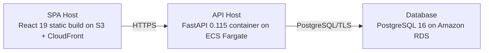

# Deployment Guide

> Maintained by QuorQ AI SDLC. Text between `sdlc:auto` markers is regenerated; anything outside them is yours and is kept.

<!-- sdlc:auto:start how-it-deploys -->
Pushes to `main` run `.github/workflows/deploy.yml`, which builds the API image (if there is a backend) and deploys the SPA to AWS Amplify. Commits touching only `docs/sdlc/**` don't deploy. Deployments can also be started from the platform's Deployment tab.
<!-- sdlc:auto:end how-it-deploys -->

<!-- sdlc:auto:start environments -->
| Name | Service | Runtime | Scaling | Environment |
|---|---|---|---|---|
| SPA Host | React 19 static build on S3 + CloudFront | Static assets (Vite build) | CDN-served, effectively unlimited for light use | dev |
| API Host | FastAPI 0.115 container on ECS Fargate | Python 3.12 / Uvicorn | 1 small task, scalable to 2 if load grows | dev |
| Database | PostgreSQL 16 on Amazon RDS | Managed PostgreSQL 16 | Single small instance with automated backups | dev |
<!-- sdlc:auto:end environments -->

<!-- sdlc:auto:start live -->
**Frontend URL:** https://p46667ac2737e.dshared.amplifyapp.local

**Backend URL:** https://46667ac2737e.local.awsapprunner.local

**Database:** PostgreSQL · aisdlc_46667ac2737e

**Version:** d2184ebb345b

**Commit:** `d2184eb`

**Finished:** 2026-11-14
<!-- sdlc:auto:end live -->

<!-- sdlc:auto:start topology -->

<!-- sdlc:auto:end topology -->
